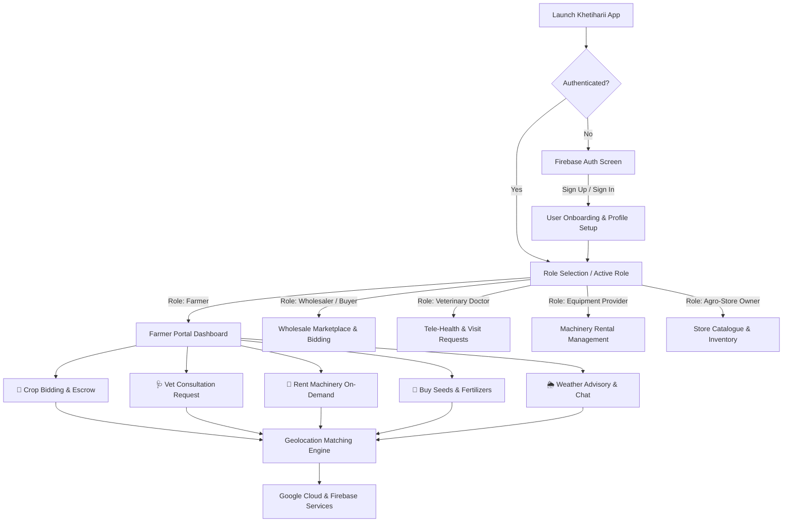
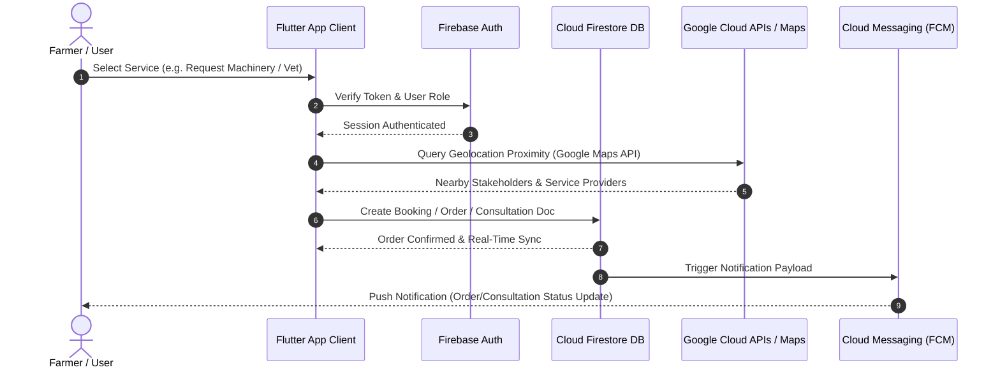

<div align="center">

  

  # 🌾 Khetiharii
  ### *Empowering Farmers through direct access to local agricultural ecosystems*

  [](https://flutter.dev)
  [](https://dart.dev)
  [](https://firebase.google.com)
  [](https://cloud.google.com)
  [](https://flutter.dev)
  [](LICENSE)
  [](#)
  [](CONTRIBUTING.md)

</div>

---

## 📋 Executive Overview & Problem Statement

Agriculture is the backbone of global food security, yet smallholder farmers regularly contend with systemic inefficiencies, predatory intermediaries, and severe resource fragmentation. **Khetiharii** is designed as a unified, end-to-end AgriTech ecosystem that bridges critical gaps across the agricultural lifecycle.

### ⚠️ Key Friction Points Addressed

1. **Fragmented B2B Markets & Middlemen Exploitation**: Traditional crop sales pass through multiple brokers, depleting farmer margins and creating opaque pricing structures.
2. **Delayed Livestock Healthcare**: Critical veterinary assistance is often unavailable in remote areas, leading to untreatable livestock diseases and severe financial losses.
3. **High Capital Expenditure for Mechanization**: Modern machinery (tractors, combine harvesters, cultivators) is economically unfeasible for individual small farms to purchase outright.
4. **Opaque Input Pricing**: Seeds, fertilizers, and crop protection products suffer from variable localized markup without price transparency or quality verification.

> [!NOTE]
> **The Khetiharii Solution**: By unifying B2B trading, veterinary tele-health, shared machinery rentals, and agro-input storefronts into a single Flutter application backed by Google Cloud & Firebase, Khetiharii delivers direct market access and real-time decision support.

> [!TIP]
> **Shared-Economy Model**: Similar to ride-hailing services, equipment providers and machinery owners can list idle assets, enabling farmers to hire tractors or harvesters on an flexible hourly/daily basis.

---

## ✨ Core Features Breakdown

| Feature Module | Description | Core Pillars & Key Capabilities |
| :--- | :--- | :--- |
| **🌾 B2B Wholesale Marketplace** | Direct Crop Sales & Bidding | Direct bulk sales without predatory middlemen, price negotiation, transparent market rates, escrow payments, and live order tracking. |
| **🩺 Veterinary Tele-Health & Visits** | Livestock Health Management | On-demand remote video/chat consultations, in-person emergency visit requests, digital health record tracking, and prescription management. |
| **🚜 Farm Mechanization On-Demand** | Heavy Equipment Sharing | On-demand rental and purchase of heavy machinery (tractors, combine harvesters, cultivators) with flexible hourly/daily rate listings. |
| **🧪 Agro-Input Shop & Comparison Engine** | Transparent Supplies Procurement | Real-time price comparison across local agro-stores for seeds, fertilizers, and pesticides with direct ordering and delivery tracking. |
| **🌦️ Hyperlocal Weather & Advisory** | Precision Agricultural Insights | Real-time micro-climate weather updates, severe weather alerts, and personalized seasonal crop management recommendations. |
| **💬 Multilateral Chat & Geolocation** | Ecosystem Communication | Geolocation proximity engine connecting farmers, buyers, vets, store owners, and equipment providers with instant messaging. |

---

## 🏗️ System Architecture & User Flow

### 1. User Onboarding & Module Routing Flow



### 2. Client-Backend Architecture Diagram



---

## 💻 Technology Stack

### Technical Matrix

| Layer | Component | Version / Specification | Description |
| :--- | :--- | :--- | :--- |
| **Frontend** | [Flutter](https://flutter.dev) | `>=3.1.0 <4.0.0` | Cross-platform framework for Android, iOS, and Web |
| **Language** | [Dart](https://dart.dev) | `>=3.1.0 <4.0.0` | Strongly typed language supporting sound null-safety |
| **State Management** | [Provider](https://pub.dev/packages/provider) | `^6.1.1` | Reactive state management and dependency injection |
| **Cloud Core** | [Firebase Core](https://pub.dev/packages/firebase_core) | `^2.24.2` | Native Firebase engine initialization |
| **Authentication** | [Firebase Auth](https://pub.dev/packages/firebase_auth) | `^4.16.0` | Secure multi-factor authentication & phone/email sign-in |
| **Database** | Cloud Firestore | Managed NoSQL | Real-time synchronization and offline caching |
| **Icons & Design** | Cupertino Icons / Icons Plus | `^1.0.2` / `^4.0.0` | Comprehensive cross-platform icon suites |
| **Typography** | [Google Fonts](https://pub.dev/packages/google_fonts) | `^2.1.0` | Dynamic runtime typography styling |
| **Location & Maps** | Google Maps / Location API | Cloud Service | Proximity matching and routing services |
| **Push Alerts** | Firebase Cloud Messaging | FCM | Real-time push notifications for orders & chats |

---

## 📂 Repository Structure

```
khetiharii/
├── .gitignore
├── README.md
├── analysis_options.yaml
├── pubspec.yaml
├── pubspec.lock
├── android/                   # Android native configuration & build files
├── ios/                       # iOS native configuration & Runner project
├── web/                       # Web entrypoint and manifest resources
├── windows/                   # Windows desktop platform support
├── linux/                     # Linux desktop platform support
├── macos/                     # macOS desktop platform support
├── test/                      # Unit & widget tests
│   └── widget_test.dart
├── assets/                    # Static image assets and imagery
│   └── images/
│       ├── bg1.jpeg
│       ├── cat.jpeg
│       ├── doctor.jpeg
│       ├── ferti.jpeg
│       ├── owner.jpeg
│       └── seller.png
├── firebase_setup/            # Firebase cross-platform configuration files
└── lib/                       # Main application codebase
    ├── main.dart              # Application entrypoint
    ├── components/            # Reusable UI component tiles & cards
    │   └── grocery_item_tile.dart
    ├── model/                 # Data models & state providers
    │   └── cart_model.dart
    ├── screens/               # Screen UI widgets & feature views
    │   ├── Category.dart
    │   ├── welcome_screen.dart
    │   ├── signin_screen.dart
    │   ├── signup_screen.dart
    │   ├── forget_passsword_screen.dart
    │   ├── home_page.dart
    │   └── cart_page.dart
    ├── theme/                 # App theming and styling configuration
    │   └── theme.dart
    └── widgets/               # Core shared widgets & custom scaffolds
        ├── custom_scaffold.dart
        └── welcome_button.dart
```

---

## 🚀 Getting Started & Local Setup

Follow these instructions to set up and run Khetiharii locally on your development machine.

### Prerequisites

Ensure you have installed the following tooling:

* **Flutter SDK**: `>=3.1.0` ([Installation Guide](https://docs.flutter.dev/get-started/install))
* **Dart SDK**: `>=3.1.0` (Bundled with Flutter)
* **Android Studio / Xcode**: For emulator/device deployment
* **Firebase CLI**: Required for modifying Firebase backend services ([Firebase CLI Guide](https://firebase.google.com/docs/cli))

### Installation Steps

1. **Clone the Repository**
   ```bash
   git clone https://github.com/your-username/khetiharii.git
   cd khetiharii
   ```

2. **Install Dependencies**
   ```bash
   flutter pub get
   ```

3. **Configure Environment & Firebase**

   <details>
   <summary><b>🔍 View Firebase & Environment Configuration Details</b></summary>
   <br />

   Create a `.env` file in the root directory (using `.env.example` as reference if applicable) or configure Firebase credentials:

   ```bash
   # Initialize Firebase for your project targets
   flutterfire configure
   ```

   Ensure your `firebase_setup/` directory contains valid configuration files (`google-services.json` for Android and `GoogleService-Info.plist` for iOS).
   </details>

4. **Run the Application**
   ```bash
   # List connected devices
   flutter devices

   # Launch on connected device or emulator
   flutter run
   ```

5. **Execute Test Suite**
   ```bash
   flutter test
   ```

---

## 🗺️ Roadmap & Future Scope

- [x] Initial UI architecture and onboarding flow
- [x] Integration with Firebase Authentication & Provider state management
- [x] Grocery & Agro-Input cart/item catalogue framework
- [ ] **IoT Sensor Integration**: Soil moisture, ambient temperature, and real-time micro-climate field monitoring.
- [ ] **AI-Driven Crop Health Scanning**: Computer vision disease diagnostics via smartphone leaf photography.
- [ ] **Agri-FinTech & Micro-Loans**: Integrated credit scoring, micro-financing, and automated crop insurance claims.
- [ ] **Supply Chain Provenance Tracking**: Blockchain/Ledger-backed farm-to-fork tracking for wholesale buyers.

---

## 🤝 Contributing, Security & License

### Contributing

Contributions are welcome! Please follow these steps:

1. Fork the repository.
2. Create your feature branch (`git checkout -b feature/AmazingFeature`).
3. Commit your changes (`git commit -m 'Add some AmazingFeature'`).
4. Push to the branch (`git push origin feature/AmazingFeature`).
5. Open a Pull Request.

### Security

If you discover any security vulnerabilities within Khetiharii, please send an e-mail or report it privately via GitHub Security Advisories.

### License

This project is released under the [MIT License](LICENSE).
